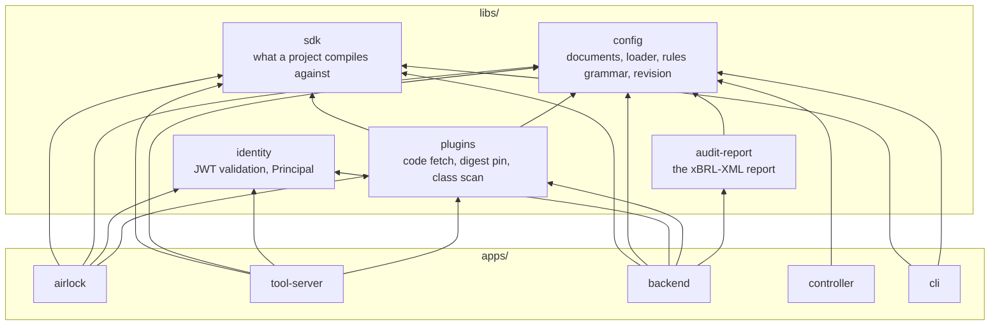
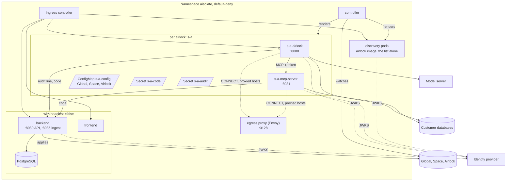
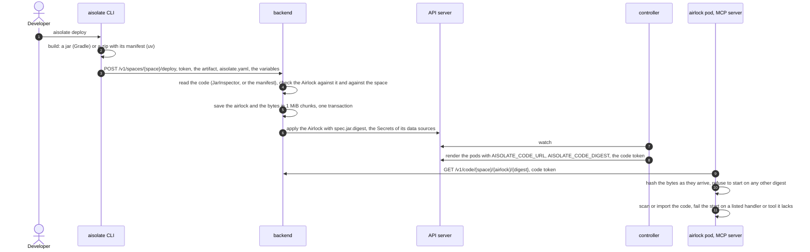
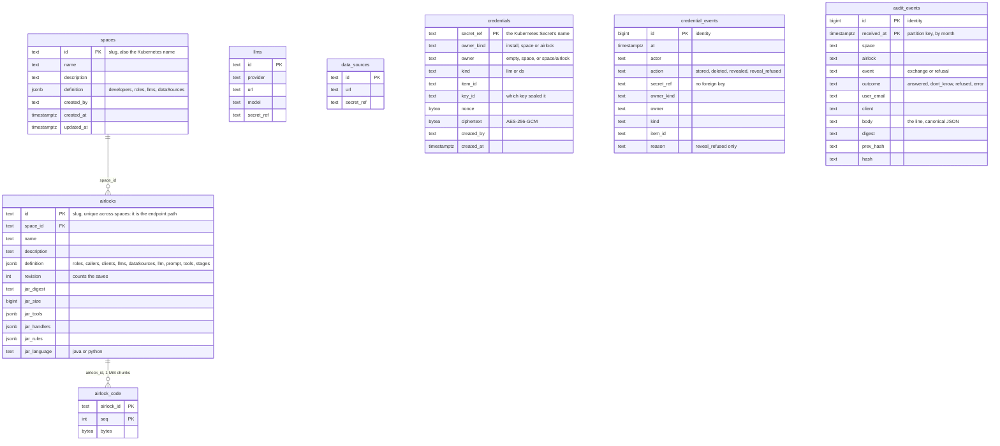

# Architecture

How AIsolate is built: the repositories, the modules of this repository and what depends on what, the two
runtimes under one contract, what runs in the cluster, how an airlock's code travels from a developer's laptop to
its pods, and where in the code one exchange runs. The vocabulary is [Concepts](concepts.md); where each guarantee
is enforced is [Security](security.md); what is stored where is [What AIsolate stores](#what-aisolate-stores); why it is built this
way is [Design decisions](design-decisions.md).

## Repositories

| Repository | Holds | Licence |
|---|---|---|
| [`aisolate`](https://github.com/reportix/aisolate) (this one) | The airlock pod and the MCP server in Java and in Python, the controller, the backend, the AIsolate UI, the sample chat client (`apps/chat`), the `aisolate` CLI with its templates, the two SDKs, the shared libraries, the conformance cases, this documentation and the CRDs the controller generates (`crds/`) | AGPL-3.0-only |
| [`aisolate-charts`](https://github.com/reportix/aisolate-charts) | The Helm chart (the CRDs copied from this repository's `crds/`, the controller, the policies, the egress proxy; with `headless=false` the UI, the backend and its database) and its tests | AGPL-3.0-only |
| [`aisolate-integrations`](https://github.com/reportix/aisolate-integrations) | An n8n node and KNIME nodes that ask an airlock as a machine client | Apache-2.0 |

## The modules of this repository

One Gradle build (`settings.gradle.kts`, Java 25), one npm workspace (`package.json`: `libs/ui`,
`apps/frontend` and `apps/chat`) and four Python modules, each with its own `pyproject.toml` and `uv.lock`. Every app depends on
libraries only, never on another app; every library depends only on the ones below it.

| Module | Framework | Listens on | Does |
|---|---|---|---|
| `apps/airlock` | Spring Boot, Spring AI, the MCP Java SDK as client | 8080, management 9464 | One airlock's endpoint: token, admission, the handlers of its code, the agent loop, grounding, the audit line, the SSE stream. No database of its own. Also the `validate` command and the discovery pods. |
| `apps/tool-server` | Spring Boot, the MCP Java SDK as server | 8081, management 9464 | The MCP server of one airlock: its tool plugins, the gates, the rules compiled into one SELECT per call on the plugin's data source. |
| `apps/controller` | Spring Boot, Java Operator SDK, fabric8 | 8082 | Watches `Global`, `Space` and `Airlock`, validates, renders the pod pair and everything around it, reports status. Generates the CRDs into `crds/` (`syncCrds`). |
| `apps/backend` | Spring Boot, JDBC, Flyway, fabric8 | 8080 for the API, 8085 for the ingest | The AIsolate UI's API and the CLI's deploy endpoint; owns the schema; applies every save to the cluster; keeps the audit trail and serves the code to the pods. Only with `headless=false`. |
| `apps/cli` | picocli, GraalVM native image | — | `aisolate create`, `login`, `logout`, `build`, `deploy`; the four templates in Java and in Python. |
| `apps/frontend` | Next.js, React, Tailwind | 3000 (3001 in development) | The AIsolate UI. Signs in with PKCE in the browser and calls the backend with the token. |
| `apps/chat` | Next.js, React, Tailwind | 3000 | The sample chat client of the airlock endpoint: sign-in with PKCE, discovery, the SSE stream, the answer with its provenance. |
| `apps/airlock-python` | Starlette, uvicorn, `mcp` as client | 8080, 9464 | The airlock pod for a Python project: the same contract as `apps/airlock`. |
| `apps/tool-server-python` | Starlette, uvicorn, `mcp` as server, pg8000 | 8081, 9464 | The MCP server for a Python project: the same contract as `apps/tool-server`. |
| `libs/sdk`, `libs/sdk-python` | plain Java; plain Python | — | `ToolPlugin`, `Entity`, `Column`, `Tool`, `GovernedQuery`, `ContextPreparator`, `ConversationMemory`, `AnswerVerifier`, `AIsolateManager`; in Python the same as classes and decorators, plus `aisolate build`. |
| `libs/config` | Jackson, no Spring | — | The three document kinds, the loader and its validation, `llmsOf` and `dataSourcesOf` over the three levels, the rules grammar, URL checks, the revision. |
| `libs/identity` | Spring Security | — | The resource-server `SecurityConfig` (issuer, JWKS, audience, the roles claim, CORS, the RFC 9728 document) and `Principal`. |
| `libs/plugins` | plain Java | — | `CodeFetch`, `JarDigests`, `JarScan`, `CatalogCheck`: fetching the code by digest and finding the plugins and handlers in it. |
| `libs/runtime-python` | Starlette, PyJWT, pg8000, OpenTelemetry | — | What both Python pods share: the server shell, the documents, the token, admission, the artifact, the data source pool, telemetry. |
| `libs/audit-report` | plain Java | — | One exchange as an xBRL-XML instance of the AIsolate Audit taxonomy. |
| `libs/ui` | React, Tailwind | — | `@aisolate/ui`: tokens, primitives, the HTTP, OIDC and env helpers of the AIsolate UI. |

### Inside a Spring Boot app

Each of `airlock`, `tool-server` and `backend` has three packages, and an `ArchitectureTest` (ArchUnit) in each
keeps them apart:

| Package | Holds | May depend on |
|---|---|---|
| `application` | The HTTP controllers and the MCP endpoint: parse the request, call the domain, shape the response | `domain` |
| `domain` | The logic: the exchange, the gates, the rules, the SQL, the audit line, the services and repositories | the SDK and `libs/config`; nothing of Spring Web or Spring Security |
| `infrastructure` | The adapters: configuration, the model and MCP clients, the cluster client, the data sources, the error handler | anything |

The rules the tests pin are the security ones: the airlock's `chat` package cannot import Spring Security or
`libs/identity`, so the agent loop never holds a token, and only the MCP client reads a token's value; nowhere may
`org.keycloak` be imported, AIsolate speaks OIDC discovery and JWKS alone; the airlock pod has no Spring JDBC and
no write endpoint; the backend has no model client and no MCP client; every backend endpoint names who may call
it through one `Access` expression.

## Two runtimes, one contract

A project is Python or Java; its airlock runs on the matching images, `aisolate/airlock-python` and
`aisolate/tool-server-python` or `aisolate/airlock` and `aisolate/tool-server`. The controller renders one pod
shape for both and swaps only the image (`spec.jar.language`): the same environment variables, the same mounts,
the same ports, the same probes on 9464 ([The pods of an airlock](configuration.md#the-pods-of-an-airlock)). The Java
runtime is the reference.

The guard is the conformance suite, `conformance/cases/*.json`: admission, token checks, the tool server's gates,
rule evaluation and the compiled statement, SQL safety, grounding, the audit line, the LLM catalog, the code fetch,
written as data once and fed to each runtime by a thin runner of its own. Neither image ships unless both runners
pass; a case that fails for one runtime is a divergence to fix, never a case to edit for one side.

| | Java | Python |
|---|---|---|
| Runtime | Java 25, Spring Boot | Python 3.13, Starlette and uvicorn, asyncio |
| Project code | a jar; the classes scanned, parent-first over the SDK | a zip with `aisolate-manifest.json`, the package and its vendored wheels; the package imported, then checked against the manifest |
| Database driver | JDBC, PostgreSQL | pg8000 (pure Python, DB-API 2.0) |
| Model client | Spring AI (`ollama`, `openai`) | httpx2, hand-written |
| MCP | MCP Java SDK, streamable HTTP | `mcp`, streamable HTTP, stateless server |
| Handlers and tools | synchronous | synchronous, run on a worker thread so one slow handler blocks no other exchange |
| Traces | Micrometer, OTLP/HTTP | OpenTelemetry SDK, a twenty-line OTLP/HTTP exporter |
| Discovery pods | yes | no: discovery always runs the Java image |

## In the cluster

- **The controller** is one Deployment per install. It watches the three kinds with the Java Operator SDK, one
  reconciler each. For a valid `Airlock` it renders the airlock pod and, when the airlock has code and lists a
  tool, its MCP server; the documents' ConfigMap; the code token Secret and the audit token Secret; the Services,
  the Ingress rule for the airlock's path and one NetworkPolicy per pod. Everything is owned by the `Airlock`, so
  deleting it takes the pair with it. Per namespace it keeps the discovery list and pods, owned by every `Space`.
  Status goes back into the resource: `phase`, `conditions`, `problems`, `readyReplicas`, `revision`.
- **The pod pair** runs under the restricted Pod Security Standard: non-root (`10001`), no capabilities, read-only
  root filesystem, seccomp `RuntimeDefault`, no ServiceAccount token, `/tmp` an emptyDir. The airlock pod reaches
  its own MCP server, the hosts of its LLMs and data sources, the identity provider, the backend's ingest port and
  the trace collector; the MCP server reaches its data sources, the identity provider, the ingest port and the
  collector; nothing else, in or out. A host on the proxy list is reached through the egress proxy, CONNECT only.
- **The backend and the UI** exist only with `headless=false`. The backend keeps what the UI defines in its own
  PostgreSQL and applies it to the cluster after every write; its ingest port serves two things to pods and nothing
  else, the audit ingest and the code fetch. The UI runs in the browser against the backend's API.
- **Headless**, the organisation's pipeline applies the documents and creates the Secrets; the same controller
  renders the same pods, and an airlock with code does not start, since no backend holds it.

What each object is named, what each pod gets in its environment and mounts, and what each policy opens:
[Names, ids and revision](documents.md#names-ids-and-revision), [The pods of an airlock](configuration.md#the-pods-of-an-airlock),
[Network policies](security.md#network-policies).

## How code travels

The code never travels through the API server or a ConfigMap, and no size limit applies but the operator's. The
backend reads a Java jar's classes to list its tools and handlers (the one place a project's Java code runs
outside its pods, [Residual risks](security.md#residual-risks)); a Python zip it reads by its manifest and never
imports. A deploy creates the airlock or updates it in place, so the pods roll and the endpoint stays. Steps and
details: [The code](configuration.md#the-code), [The Python artifact](python-artifact.md).

## One exchange, in the code

The steps are those of [One request, step by step](security.md#one-request-step-by-step); the gates are numbered as
there.

| Step | Java | Python |
|---|---|---|
| The request, gate 1 | `ChatController`; `SecurityConfig` of `libs/identity` | `aisolate_airlock.app`; `aisolate_runtime.identity`, `server` |
| Gate 2, admission | `AirlockAdmissionService` over `AirlockCatalog` | `aisolate_runtime.admission` |
| The exchange and the handlers | `ChatExchange`, `HandlerChain`, `Handlers`, `HandlerCatalog`; the handlers get an `AIsolateManager` from `ExchangeManagerFactory` | `aisolate_airlock.exchange` |
| The agent loop and the model | `AgentLoopService`; `LlmCatalog`, `OllamaLlm`, `OpenAiLlm` | `aisolate_airlock.llm`, `prompts` |
| Gate 3, the tools | `GovernedToolCallback`, `UnknownToolCallback`; `McpSyncToolClient` | `aisolate_airlock.mcp_client` |
| Gate 4, the MCP server's token | `SecurityConfig` of the tool server | `aisolate_runtime.identity` |
| Gate 5, policy, rules, SQL | `GovernedToolsConfig` → `GovernedQueryService` with `PolicySource`, `Policy`; `RulesEvaluator` → `Obligations`, `RowPredicate`; `ToolArgs`; `SqlCompiler` → `CompiledQuery`; `CustomerDataSources` | `aisolate_tool_server.app`, `governed`, `rules`, `sql`; `aisolate_runtime.datasources` |
| The evidence | `ToolEvidence`; `Result`, `Evidence` of the SDK | `aisolate_airlock.evidence` |
| Gate 6, grounding | `AnswerFormat`, `Grounding`, `GroundedAnswer` | `aisolate_airlock.answer_format`, `grounding` |
| Gate 7, the verifiers | `HandlerChain` over the `AnswerVerifier` handlers | `aisolate_airlock.exchange` |
| The stream | `SseStream`, `ChatEvent` | a Starlette `StreamingResponse` in `aisolate_airlock.app` |
| The audit line | `ExchangeAudit`, `AuditEvent`, `AuditLog`, `AuditSink` | `aisolate_airlock.audit` |
| The trace | `ExchangeTracing`, `OwnTraceFilter`; `TracingConfig` of `libs/identity` | `aisolate_airlock.tracing`; `aisolate_runtime.telemetry` |
| The documents and the revision | `ConfigurationLoader`, `Configuration`, `Names`, `Urls` of `libs/config` | `aisolate_runtime.config` |
| The code at start | `PluginsConfig` (both pods), `PluginLoader`, `PluginCatalog`, `RuleSetFiles`; `CodeFetch`, `JarDigests`, `JarScan`, `CatalogCheck` of `libs/plugins` | `aisolate_runtime.artifact`; `aisolate.build` `discover` and `check` |

The backend's side: one controller per resource kind (`SpaceController`, `AirlockController`,
`GlobalController`), the deploy (`DeployController` → `DeployService`, `JarInspector`, `ManifestReader`,
`DocumentForms`), the code fetch (`CodeController`), the audit (`AuditIngestController` on the ingest port;
`AuditController`, `AuditService`, `AuditExport`, `AuditRetention`), Monitoring (`TraceController`, `MetricsController`, `JaegerClient`, `PrometheusClient`),
and `ClusterSyncService`, which turns the rows into documents (`Documents`) and applies them. The controller's:
`AirlockReconciler`, `SpaceReconciler`, `GlobalReconciler`, the validation in `Release`, the rendering in
`Renderer`, the CRD generation in `CrdGeneration`. The CLI's: `AIsolateCli` with one class per command,
`Templates`, `GradleBuild` and `PythonBuild`, `DeployClient`, `BrowserLogin` and `Session`.

## Build, test, ship

| | Command | Runs |
|---|---|---|
| Java | `./gradlew check` | Spotless; every module's tests, the integration ones against real Keycloak and PostgreSQL containers (Testcontainers); the templates' code compiled and tested against the SDK (`templateTest`); `pythonTest` |
| Python | `./gradlew pythonTest` (part of `check`) | each Python module's tests and the Python templates', with uv; the conformance runners among them |
| Web | `npm run lint && npm run format && npm test && npm run build` | the workspace: ESLint, Prettier, Vitest, the Next.js build |
| CRDs | `./gradlew :apps:controller:syncCrds` | the three CRDs written into `crds/` from the controller's resource classes; the chart, its tests and its pin script, which copies them, are in `aisolate-charts` |
| CI | `.gitlab-ci.yml` | `check`, `test` (Docker-in-Docker for Testcontainers) and a version gate (every merge request bumps `version=` in `gradle.properties`) on every pipeline, `package` (`cli-windows-installer`, the Windows CLI's installer) by hand; every merge to `main` publishes the images as `<version>-<sha10>` to the internal registry through the fleet's release component, and the fleet's vulnerability scan runs on `main`; a tag `X.Y.Z` publishes the public images ([Release](release.md#how-aisolate-itself-is-released)) |

Images: the Java apps on a distroless Java 25 base and the Python apps on a distroless Python 3.13 base, both
pinned by digest, neither with a shell or a package manager (the Python dependencies come from a
`python:3.13-slim` build stage with `uv sync --frozen`), the UI on `node:24-alpine` as a standalone Next.js build; every one a numeric non-root user,
the Python dependency tree checked for licences in the image build. Versions are pinned (`gradle.lockfile`
per module, `uv.lock`, `package-lock.json`) and scanned in CI. Every dependency is permissive (Apache, MIT, BSD,
PSF, ISC); the product itself is AGPL-3.0-only ([Design decisions](design-decisions.md#permissive-dependencies-only)).

## What AIsolate stores

No business data lives in any of these stores: the organisation's rows and passages stay in its databases, read at
the moment of an exchange and never kept. What the controller renders from the documents is in
[Release](release.md#what-the-controller-renders), the audit trail's line and table in [Audit](audit.md#storage).

### Three stores

| Store | Holds | Owned by | Exists |
|---|---|---|---|
| The documents | `Global`, `Space`, `Airlock`: what runs, who may ask, which LLMs and data sources, the code's digest | the cluster; written by the backend or the organisation's pipeline | always |
| The backend's PostgreSQL | what the AIsolate UI defines (spaces, airlocks, the global LLMs and data sources), each airlock's code bytes, and the audit trail | the backend, which runs its Flyway migrations (the V1 baseline and `V2__roles.sql`) | with `headless=false` |
| Secrets | each data source's user and password, each `openai` LLM's API key; per airlock the code token and the audit token | the document that defines the data source or LLM; the controller for the two tokens | always |

The documents are the interface between the two halves: the backend writes them, the controller reads them, and
nothing a pod needs comes from anywhere else. A headless install writes them by hand and has no PostgreSQL.

### The backend's tables

The V1 baseline, `V1__baseline.sql`, and `V2__roles.sql`. The backend owns the schema and no other process writes it.

- **`spaces`, `airlocks`.** The form the UI edits, as the row's columns and one `definition` JSON. A space's
  definition lists its developers (e-mails) and its roles; an airlock's lists its own roles, callers and
  machine clients, its LLMs and data sources, and what runs, which a deploy brings. The ids are URL slugs
  (`^[a-z]([a-z0-9-]{0,39}[a-z0-9])$`) and name Kubernetes objects too, so an airlock's id is unique across spaces
  and `<space>-<airlock>` may collide with no other pair ([Names, ids and revision](documents.md#names-ids-and-revision)).
- **`airlock_code`.** The artifact's bytes in 1 MiB chunks, numbered by `seq`, written and read a chunk at a
  time: neither a deploy nor a pod's fetch holds the artifact in memory, and no size ceiling applies but the
  operator's. The `jar_*` columns beside it hold what the backend read from the artifact: its digest and size,
  the tools with their plugin and data source, the handlers with their stage and order, the rule sets.
- **`llms`, `data_sources`.** The global level, the admin's. A space's and an airlock's own live in their
  `definition`. An LLM has no type: the same entry chats or embeds as its model can. A credential is never a
  column of these tables: `secret_ref` names the Secret, and the value sits in `credentials`.
- **`credentials`.** One row per typed credential, keyed by the Kubernetes Secret's name: the owner level, the
  kind (`llm` or `ds`), the item's id, and the values sealed as JSON with AES-256-GCM under
  `AISOLATE_CREDENTIALS_KEY` (`nonce`, `ciphertext`, `key_id` the first eight hex characters of the key's
  digest). The `secret_ref` is the associated data, so a ciphertext moved to another row does not open. A row goes
  when its Secret does. A row of a Secret made before this table has none: its reveal is 409.
- **`credential_events`.** Who stored, deleted, revealed or was refused a reveal (`reason`), never a value.
  Append-only as `audit_events`: the backend writes it as `aisolate_audit_writer`, which may INSERT and SELECT,
  and triggers refuse UPDATE, DELETE and TRUNCATE. No foreign key: events outlive their rows
  ([Security, Credentials](security.md#credentials)).
- **`audit_events`.** The trail ([Audit, Storage](audit.md#storage)).

## Read next

- [Design decisions](design-decisions.md): why it is built this way.
- [Configuration](configuration.md#the-pods-of-an-airlock): every environment variable, mount, port and check a pod must honour.
- [Contributing](../CONTRIBUTING.md): running it on a laptop, the layout, the conventions.
