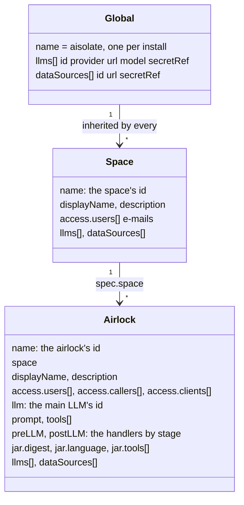
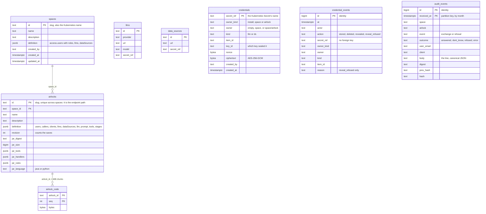
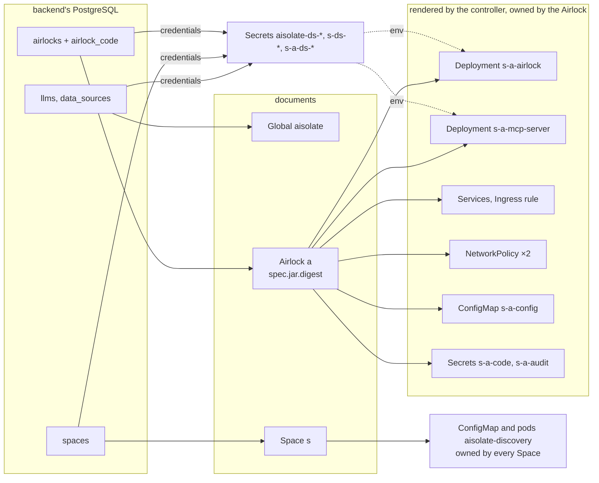

# Data model

What AIsolate stores, where, and how one shape becomes the next: the three documents the pods run from, the
backend's tables behind the AIsolate UI, the objects the controller renders from the documents, and the audit
trail. No business data lives in any of them: the organisation's rows and passages stay in its databases, read at
the moment of an exchange and never kept.

## Three stores

| Store | Holds | Owned by | Exists |
|---|---|---|---|
| The documents | `Global`, `Space`, `Airlock`: what runs, who may ask, which LLMs and data sources, the code's digest | the cluster; written by the backend or the organisation's pipeline | always |
| The backend's PostgreSQL | what the AIsolate UI defines (spaces, airlocks, the global LLMs and data sources), each airlock's code bytes, and the audit trail | the backend, which runs its one Flyway migration | with `headless=false` |
| Secrets | each data source's user and password, each `openai` LLM's API key; per airlock the code token and the audit token | the document that defines the data source or LLM; the controller for the two tokens | always |

The documents are the interface between the two halves: the backend writes them, the controller reads them, and
nothing a pod needs comes from anywhere else. A headless install writes them by hand and has no PostgreSQL.

## The documents

Three kinds, one API group, `aisolate.dev/v1`. The fields are those of [Documents](documents.md); what matters
here is who holds what.

- **Resolution.** An airlock sees three lists of LLMs and three of data sources: the global, its space's and its
  own. The same id at a nearer level replaces the farther one whole; other ids add up; the result is sorted by id.
  `libs/config` does it once (`Configuration.llmsOf`, `dataSourcesOf`), the controller renders the result into
  the pods' environment, and the pods never resolve levels themselves.
- **Status.** Each resource carries `phase`, `conditions`, `problems`, `readyReplicas`, `observedGeneration` and
  `revision`, written by the controller. An `Airlock` that fails validation is Invalid and runs nothing; its
  problems say why.
- **Revision.** Twelve hex digits of the SHA-256 of the three documents an airlock serves. Both pods carry it,
  every response and every MCP call carries it, every evidence's `rule_version` starts with it. A change to an
  airlock restarts that airlock's pods; to a space, those of every airlock in it; to the `Global`, every airlock's.
  It is not the airlock's `revision` column below, which counts saves.

## The backend's tables

One baseline migration, `V1__baseline.sql`. The backend owns the schema and no other process writes it.

- **`spaces`, `airlocks`.** The form the UI edits, as the row's columns and one `definition` JSON. A space's
  definition lists its users with their role (Developer or User); an airlock's lists its own users, callers and
  machine clients, its LLMs and data sources, and what runs, which a deploy brings. The ids are URL slugs
  (`^[a-z]([a-z0-9-]{0,39}[a-z0-9])$`) and name Kubernetes objects too, so an airlock's id is unique across spaces
  and `<space>-<airlock>` may collide with no other pair ([Names, ids and revision](documents.md#names-ids-and-revision)).
- **`airlock_code`.** The artifact's bytes in 1 MiB chunks, numbered by `seq`, written and read a chunk at a
  time: neither a deploy nor a pod's fetch holds the artifact in memory, and no size ceiling applies but the
  operator's. The `jar_*` columns beside it hold what the backend read from the artifact: its digest and size,
  the tools with their plugin and data source, the handlers with their stage and order, the rule sets.
- **`llms`, `data_sources`.** The global level, the admin's. A space's and an airlock's own live in their
  `definition`. An LLM has no type: the same entry chats or embeds as its model can. A credential is never a
  column of these tables: `secret_ref` names the Secret, and the value sits in `credentials`.
- **`credentials`.** One row per typed credential, keyed by the Kubernetes Secret's name: the owner level, the
  kind (`llm` or `ds`), the item's id, and the values sealed as JSON with AES-256-GCM under
  `AISOLATE_CREDENTIALS_KEY` (`nonce`, `ciphertext`, `key_id` the first eight hex characters of the key's
  digest). The `secret_ref` is the associated data, so a ciphertext moved to another row does not open. A row goes
  when its Secret does. A row of a Secret made before this table has none: its reveal is 409.
- **`credential_events`.** Who stored, deleted, revealed or was refused a reveal (`reason`), never a value.
  Append-only as `audit_events`: the backend writes it as `aisolate_audit_writer`, which may INSERT and SELECT,
  and triggers refuse UPDATE, DELETE and TRUNCATE. No foreign key: events outlive their rows
  ([Security, Credentials](security.md#credentials)).
- **`audit_events`.** The trail, below.

## From a row to a pod

`ClusterSyncService` turns the rows into the three documents (`Documents`) and applies them after every write,
together with one Secret per data source that carries credentials, owned by the document that defines it. The
controller does the rest:

| From | The controller renders | Notes |
|---|---|---|
| a valid `Airlock` with `llm` and `prompt` | the airlock pod's Deployment, Service, Ingress rule and NetworkPolicy; the ConfigMap with the `Global`, its `Space` and itself; the audit token Secret | an `Airlock` without `llm` or `prompt` renders no pod |
| … that has code and lists a tool | the MCP server's Deployment, Service and NetworkPolicy; the code token Secret, mounted into both pods | an airlock with handlers and no tool has an airlock pod only, which still fetches the code |
| every valid `Space` | one entry in the discovery ConfigMap: each airlock's id, name, description, callers, tools, and its users as the SHA-256 of the lower-cased e-mail | no prompt, model, data source or Secret name; the discovery pods mount this list alone |
| each resource | its status | `phase`, `conditions`, `problems`, `readyReplicas`, `revision` |

A pod receives the resolved catalog as environment, `AISOLATE_LLM_<i>_*` and `AISOLATE_DATASOURCE_<i>_*` sorted
by id, the credentials from each Secret, and the documents as files under `/etc/aisolate` whose hash must equal
`AISOLATE_CONFIG_REVISION`, or it refuses to start. The full list: [The runtime contract](runtime-contract.md#1-pod-inputs).

## The audit trail

One JSON line per exchange and per refused request, written by the airlock pod, kept by the backend
([Audit](audit.md)). The line is the record; the columns of `audit_events` are read from it for the filters, and
verify checks they still agree with it.

| Field | Holds |
|---|---|
| `ts`, `space`, `airlock`, `revision`, `trace_id` | when, which airlock at which revision, the trace it belongs to |
| `event`, `outcome`, `reason` | `exchange` or `refusal`; `answered`, `dont_know`, `refused` or `error`; a refusal's `user` or `client` |
| `user_email`, `client` | who asked: the e-mail, or for a machine client its client id and no e-mail |
| `question`, `answer` | the exchange's text, here and nowhere else in AIsolate |
| `figures_sourced`, `figures_computed`, `figures_unsourced`, `figures_mismatch` | the answer's figures by provenance ([Verification](verification.md)) |
| `input_tokens`, `output_tokens`, `duration_ms` | the model's tokens and the exchange's duration |
| `body` | the line itself, its JSON with sorted keys: the above plus the tools called with their row counts, the evidence ids and the verdicts |
| `digest` | SHA-256 of the body: a retried line is stored once |
| `prev_hash`, `hash` | the chain: `hash = sha256(prev_hash || body)` per airlock, the first line's `prev_hash` 64 zeros |

- **Append-only.** The backend writes and reads the table as the role `aisolate_audit_writer`, which may INSERT
  and SELECT and nothing else; a trigger refuses UPDATE, DELETE and TRUNCATE whoever asks, the owner included.
- **Partitioned by month** on `received_at`. Retention drops whole months as partitions; nothing else ever
  leaves. The current and the next month's partitions exist from the migration on; the retention job creates
  the ones after.
- **Tamper-evident.** `GET /v1/audit/verify?space=&airlock=` walks the chain again and names the first line that
  fails, `altered` or `removed`. What that proves and what it does not: [Audit trail](security.md#audit-trail).
- **One token per airlock.** The pod hands its lines over with `base64url(HMAC-SHA256(ingestKey, "s/a"))`,
  rendered by the controller into `s-a-audit`; the backend takes a line only with the token of the airlock it
  names and keeps no table of tokens. The same key, under `code/s/a`, is the code token.
- **Indexes** on the chain (`space, airlock, id`), the digest and the trace id.

## Read next

- [Documents](documents.md): every field of the three kinds, the project file, rule sets, validation.
- [Audit](audit.md): the trail end to end, the AIsolate Audit taxonomy, the exports.
- [Architecture](architecture.md): the modules and the pods these shapes flow through.
