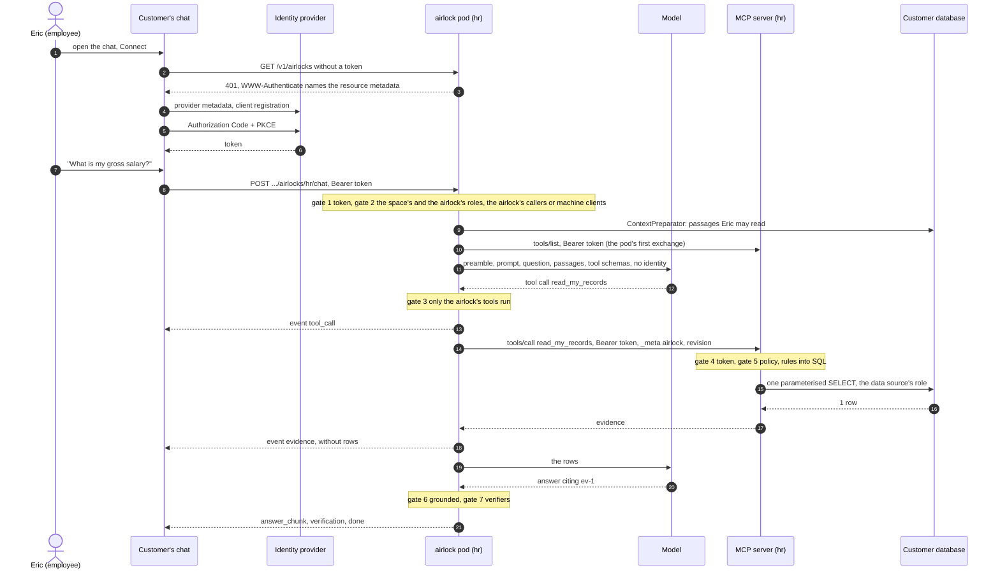

# Security

Where each guarantee is enforced: identity end to end, the model is never an enforcement point, rules compiled
into SQL at the data boundary, deny is silent, context is developer code.

## One request, step by step



| Situation | Result |
|---|---|
| No token, forged signature, expired token, token for another audience | 401 before any model or data access |
| Valid token, no role the space or the airlock lists, an `azp` the airlock does not admit, or no e-mail and an `azp` that is none of the airlock's `access.clients` | 403 "forbidden"; the reason goes to the pod's log and one `refusal` line to the [audit trail](#audit-trail) |
| Rules yield no row (another person's record, an aggregate no rule grants, a group below `min_group_size`) | 0 rows, answer "I don't know" when no other evidence holds anything; never a 403 |
| A user the airlock admits whose roles match no rule | 0 rows from every tool, never a 403. The airlock's context preparators still run and pass on what their code chooses: who may ask the airlock is the gate for everything it serves ([Context preparators](#context-preparators)) |
| A user whose role only another airlock of the space lists | 403 on this airlock, and 0 rows from its MCP server: an airlock's own roles may ask that airlock alone |
| Model calls a tool the airlock does not list | Call dropped, model told the tool is unavailable |
| Model names an unknown, hidden or masked column, or an unknown operator | Tool error "Invalid arguments", no SQL built |
| Database or driver failure in the MCP server | Fixed tool error by kind (login refused, unreachable, failed) with its data source id, no SQL text or credential leaks |
| The MCP server cannot be listed | `error` event; the exchange fails closed |

## The gates

| Gate | Where | Checks | On failure |
|---|---|---|---|
| 1 | airlock pod, `SecurityConfig` of `libs/identity` | Issuer, JWKS signature, expiry, `aud = aisolate` | 401 with `WWW-Authenticate: Bearer resource_metadata=…` |
| 2 | airlock pod, `AirlockAdmissionService` | a token role in the space's `access.roles` or the airlock's own, exact; `azp` in the airlock's `access.callers` (`*` admits any client registered at the identity provider). A token without an `email` whose `azp` is exactly one of the airlock's `access.clients` is admitted instead, the callers not consulted (`*` is no wildcard there). No `email` is needed for a person | 403 "forbidden"; the audit trail one `refusal` line with `reason` `role` or `client` |
| 3 | airlock pod, `ChatExchange` and `AgentLoopService` | Only the tools the airlock lists become callbacks; any other name resolves to a stub that answers instead of running; arguments must be a JSON object; at most three tool calls per exchange | Call dropped and the model told, or `error` event |
| 4 | MCP server, `SecurityConfig` | The same token checks as gate 1, independently | 401 |
| 5 | MCP server, `GovernedQueryService` with `RulesEvaluator` and `SqlCompiler` | The airlock named in `_meta` at the revision the server loaded; the same admission as gate 2 (the space's and the airlock's roles, the airlock's callers and machine clients; the roles also select the rules) and the tool list re-checked; the tool's plugin and its data source; rules evaluated for the action; arguments validated against the catalog; obligations compiled into the SQL | Silent: evidence with `row_count 0`, never an error the model could read |
| 6 | airlock pod, `ChatExchange.ground` | Every evidence empty, or tools failed without evidence | Answer replaced by "I don't know" |
| 7 | airlock pod, the `AnswerVerifier` handlers the airlock lists | Each verifier judges the finished answer against the evidence | A `verification` event with the verdicts; the answer is never blocked |

ArchUnit rules keep the chain honest. The chat package cannot depend on Spring Security or on the identity
code, so the agent loop has no way to reach the token; only the MCP client may read a token's value. Nowhere
may `org.keycloak` be imported: AIsolate speaks only OIDC discovery and JWKS. The airlock pod has no database
of its own, no Spring JDBC and no write endpoint; it hands the airlock's handlers a `javax.sql.DataSource` per
data source the airlock resolves. The backend has no model client and no MCP client. Every backend endpoint
names who may call it,
with one exception the rules pin by name: the audit ingest,
which no user calls ([Audit trail](#audit-trail)).

## Identity

One token, issued at login and validated by every AIsolate process it reaches. Two trust domains: the **operators**
(admins, auditors, developers: the UI and the CLI) are trusted by the backend, and the
**application users** (who ask airlocks) by the airlock and MCP pods; by default one provider
serves both. With two providers, a token of one domain presented in the other is refused (401, issuer mismatch). AIsolate ships no identity provider. A space and an airlock list the roles they admit
([Roles](concepts.md#vocabulary)); the identity provider authenticates the people and holds who has them. A
space lists its developers by e-mail: they edit in the UI and are no askers. People live in the identity provider
alone. AIsolate holds no service account there and no directory: it never searches, creates, invites or deletes a person.

| Claim | Example | Used for |
|---|---|---|
| `iss` | `http://localhost:8180/realms/acme` (application users, the pods); `…/realms/aisolate` (operators, the backend) | The trusted issuer of that process; the JWKS come from here |
| `sub` | the identity provider's user id | Stable subject |
| `email` | `eric@example.com` | The user, fed to row filters and the audit line, not to admission; the business key the identity join matches to the organisation's records. A machine client's token has none |
| `realm_access.roles` | `["employee"]` | Admission (a role the space or the airlock lists, exact) and rule selection; the claim path is `AISOLATE_ROLES_CLAIM` |
| `aud` | `aisolate` | Every AIsolate process refuses tokens meant for other services |
| `azp` | the calling client's id | The calling client, checked against the airlock's `access.callers`; on a token without an `email`, the machine client, checked against the airlock's `access.clients` |
| `exp` | five minutes after login | Refresh with rotation in the browser |

The token is never exchanged. The airlock pod forwards it unchanged to its MCP server on every call, and the
MCP server validates it against the same issuer and audience. A compromised airlock pod cannot invent a user:
it can only replay tokens it holds, for their remaining lifetime. The model gets none of this: `Principal` is
built only from validated claims plus the identity join, never from tool arguments, the prompt or the request
body, and the agent loop receives no identity at all. Operators and application users carry the same audience but come from their own issuers;
each process accepts the one issuer it is set to, and roles decide what each may do.

## Rules become SQL

**Evaluation.** Default deny: no matching rule means no rows. An explicit deny wins over any allow. Several
matching allows combine: the union of their row filters, the union of their hidden and masked columns (hidden
beats masked), the largest `min_group_size`. A row filter that needs an attribute the user does not have (an
employee with no row in `hr.employees`) denies. The rule-set format is in [Rule set](documents.md#rule-set).

**Tool arguments.** `read_records` takes optional `filters` and a `limit`, capped at 100 by the platform; a
plugin caps lower (the templates at 20 rows, the auditor at 50). `aggregate_records`
takes a `function` (`sum`, `avg`, `count`, `min`, `max`), a `column`, an optional `group_by` and optional
`filters`. A filter is `{column, op, value}` with `op` one of `eq`, `neq`, `gt`, `gte`, `lt`, `lte`, `ilike`
(`ilike` on text columns only), at most ten filters a call. Every column is resolved against the entity
catalog and must be visible for this user: hidden and masked columns are not queryable, because a predicate on
a masked column would reveal its value. Values are bound as parameters with the column's type. Under a
`min_group_size`, `min` and `max` are refused: they return one person's value whatever the group's size.

**Catalog and SQL.** The catalog the plugin declares is the allow-list of what a tool may query. SQL is
assembled from the catalog's own expressions; model text never enters it, and the model's filters can only
narrow the result. The shape, columns shortened:

```sql
-- read_records for Eric (own-record): self flag, masked iban, no internal_notes, row filter AND model filters
SELECT (c.employee_id = ?) AS self, c.employee_id AS employee_id, e.full_name AS full_name, ..., '****' AS iban
FROM hr.compensation c JOIN hr.employees e ON e.id = c.employee_id
WHERE (c.employee_id = ?) AND (e.full_name ILIKE ?)
ORDER BY c.employee_id LIMIT ?
```

The query runs on the data source the tool's plugin names, as its own role (SELECT on the entities' tables, a
statement timeout).
The MCP server's pool is read-only whatever the role allows. The tool returns an evidence document: entity, row
count, columns, rows, rule version, matched rule names and a hash of the SQL shape. Rows travel to the model,
never to the browser.

## Deny is silent

The evidence says `row_count 0`, every
evidence is empty, and the answer becomes exactly "I don't know", whatever the model wrote.
The model is never told what lies behind a rule, and no
answer ever reads "access denied".

## Credentials

Every data source has a URL, a user and a password; a model served by an OpenAI-compatible server may have an
API key. The URL is stored and shown; the user, the password and the key are typed once. The backend seals
them with AES-256-GCM under `AISOLATE_CREDENTIALS_KEY` into one row of `credentials` per Secret, keyed by the
Secret's name (`secret_ref`), with a fresh nonce per row and the name as associated data, so a ciphertext moved
to another row does not open. It writes the same values into one Secret per credential, owned by the `Global`,
`Space` or `Airlock` resource that defines it, and the rows keep only its name. The backend's Role may create
and delete Secrets, never read, list or patch them: the Secret is for the pods, the row is the backend's own
copy.
No password sits in a
document, and no pod reads Secrets from the Kubernetes API. The Secrets themselves are stored as the cluster
stores them; AIsolate uses no external secret store.

An admin reads a credential back. `POST /v1/credentials/{secretRef}/reveal` answers it to a caller with the
realm role `aisolate-admin` whose login is fresher than five minutes, by the token's `auth_time`
(`AISOLATE_CREDENTIALS_REVEAL_MAX_AGE`); an older login is 403 `sign in again to reveal`, and the UI sends the
browser to the identity provider and back. The reveal takes tokens of the AIsolate UI's client alone, by the
token's `azp` (`AISOLATE_CREDENTIALS_REVEAL_CLIENTS`, default `aisolate-ui`): the CLI's and a chat client's
tokens are refused (403 `not from the AIsolate UI`), as is a token without `azp`. A token without `auth_time`
cannot reveal either.
Through the API a developer can replace a credential,
never read it. A Java deploy is the exception (see the residual risks): its code runs in the backend, which
holds the key.

Every store, delete, reveal and refused reveal is one row of `credential_events`: who, when, which Secret and
level, and for a refusal why.
It is append-only as `audit_events` is, written as the role `aisolate_audit_writer` with triggers
that refuse UPDATE, DELETE and TRUNCATE, and no value is ever in a row, a log line or a list response.

## Pod isolation

AIsolate's guarantees are application code, and they hold while the code behaves. The pod pair is the layer
that holds when it does not: a model steered into a tool call by a prompt injection, hostile or buggy code in an
airlock, a remote code execution in a dependency. A beaten process reaches only what its own pod may reach. A
deploy runs a Java airlock's code in the backend as well, outside this boundary ([Residual risks](#residual-risks));
a Python airlock's code never runs there.

| Layer | Bounds | Mechanism |
|---|---|---|
| Application | what may be said: rows, passages, tools, the text that leaves | token validated twice, admission, rules into SQL, silent deny, evidence |
| Network | what each pod reaches | the namespace's default-deny and one policy per pod, below |
| Code | what runs | images pinned by digest, the chart and the controller both refusing a reference without one; the Java images are distroless (a JRE and its libraries, no shell, no package manager), the Python ones the same with the interpreter; each airlock's code fetched from the backend at start and its sha256 checked against the digest its `Airlock` names, a mismatch or a failed fetch failing the start ([Where an airlock's code comes from](#where-an-airlocks-code-comes-from)); read-only root filesystem, the fetched code only in the pod's `/tmp` |
| Credentials | what each pod holds | both pods of an airlock hold the roles of the data sources the airlock resolves, and nothing of any other airlock; neither holds a ServiceAccount token |
| Discovery | which pod a user's token reaches outside its airlock's path | the release's `aisolate` Service selects only the discovery pods: the airlock image with the `aisolate-discovery` list alone, no documents, no code, no data source, no model, so discovery and a stray chat path (404) carry no token to an airlock's code. |
| Process | memory, CPU, rollout | its own pod with limits, under the restricted Pod Security Standard (non-root, no capabilities) |
| Kernel | what a kernel exploit reaches | `platform.airlock.runtimeClassName` (gVisor, Kata) on every pod the controller renders: airlock, MCP server and discovery |

The isolation is only as real as the cluster's CNI: a CNI without NetworkPolicy support enforces nothing and
says nothing. `helm test` proves from inside the cluster that an airlock pod and an MCP server are unreachable
except through the ingress.

## Network policies

| From | To | Allowed |
|---|---|---|
| ingress controller | airlock pod `:8080` | the airlock's chat path |
| ingress controller | discovery pod `:8080` | discovery, `/.well-known/` and any chat path no airlock's rule matches (404), through the release Service |
| airlock pod | its own MCP server `:8081` | `POST /mcp` with the token, the only ingress the MCP server's policy admits |
| airlock pod | the admin's peer for the host of every LLM URL of the airlock's catalog | the model API |
| airlock pod, MCP server | the admin's peer for the host of every data source the airlock resolves | the data sources' roles |
| airlock pod, MCP server, discovery pod | the identity provider | JWKS and discovery, directly or through the egress proxy |
| airlock pod, MCP server, discovery pod | kube-dns | port 53 |
| airlock pod, MCP server, discovery pod | the admin's peer for the host of `platform.observability.otlpEndpoint`, when set | traces over OTLP/HTTP, names and counts only ([Observability](observability.md#what-never-goes-into-a-span)) |
| a pod labelled `aisolate.dev/scraper: "true"`, any namespace | airlock pod, MCP server, discovery pod `:9464`, the management port no Service exposes | `/actuator/prometheus` without a token, and health; nothing else listens there ([Observability](observability.md#metrics)) |
| airlock pod, MCP server | the backend's ingest port `:8085` (with the AIsolate UI) | the airlock pod `POST /v1/audit/events`, both `GET /v1/code/…` of their own airlock; the port answers nothing else |
| backend (with the AIsolate UI) | the peer and port of `platform.metrics.egress`, when `platform.metrics.queryUrl` is set | Prometheus's HTTP API, the backend's fixed queries for Monitoring's charts, scoped by the series' `space` label |
| backend (with the AIsolate UI) | the peer and port of `platform.tracing.egress`, when `platform.tracing.queryUrl` is set | the trace store's query API, `GET /api/traces/{id}` for Monitoring's trace page; the browser never calls it ([Observability](observability.md#in-the-aisolate-ui)) |
| anything else | airlock pods, MCP servers, discovery pods | denied |

With the AIsolate UI installed, its pods share the namespace with their own policies inside the default-deny.
A host on `platform.egress.proxy.domains` gets no direct rule: the pods reach it through the egress proxy
(CONNECT only, port 443, exact names, every connection logged). An airlock whose resolved URLs name a host
neither mapped nor proxied is Invalid and runs nothing.

## Where an airlock's code comes from

A deploy brings the airlock's artifact (a jar, or a Python zip with its dependencies) to the backend, which keeps
it in its database with its digest, `sha256:<hex>` of the bytes; the `Airlock`'s `spec.jar.digest` names
it. At start each of the airlock's two pods fetches it from the backend's ingest port, `GET
/v1/code/<space>/<airlock>/<digest>`, with the airlock's code token
mounted into those two pods alone.
The pod writes the bytes to its `/tmp` (the root filesystem stays read-only), hashes them as they arrive
and refuses to start unless they hash to the digest;
the pod is not Ready until the code is loaded. The code
never travels through the API server or a ConfigMap, and no artifact size limit applies but the operator's
(`platform.backend.maxArtifactSize`).

## Context preparators

The developer's `ContextPreparator` handler runs in the airlock pod before the model sees the question. It
embeds the question through an LLM of the airlock's catalog (`aisolate.llm("nomic").embed(...)`), reads its data source by id
(`aisolate.dataSource("hr")`) as that source's role, keeps what the user's roles and e-mail allow
and adds the closest passages to the context under an evidence id. The predicates are the handler's own code.

The rules filter only what the tools return. A context preparator's passages reach every user the airlock admits,
as far as its own predicates let them, and they are evidence: gate 6 keeps the answer when they hold anything.
Who may ask an airlock is the gate for everything it serves, so list on the space only the roles whose holders may see all
of what every airlock's context preparators read, and on an airlock only those who may see all of its.

| Threat | Enters through | Held by | Left to the developer |
|---|---|---|---|
| Indirect prompt injection: a document carries instructions | the passages in the model's context | no credential in the prompt; passages and handler context travel in a user-role `<context>` message the preamble calls data, never in the system message; only the airlock's governed tools are callable; only text leaves | a wrong figure or misleading advice: `AnswerVerifier` handlers annotate, they do not block |
| Ranking leak: filtering after top-k reveals a restricted passage by its absence | the search query | the audience and owner predicates in the `WHERE` clause, before `ORDER BY` and `LIMIT`, as the template has them | the handler author's invariant |
| Embedding egress: questions and sections go to the embedding model | the embedding call | an LLM of the airlock's catalog, a local Ollama in the demo | a confidential corpus needs an embedding model inside the network |
| Model egress: an OpenAI-compatible model outside the network receives the questions, passages and tool results | the main LLM and code's `llm(id)` calls | its host must be one the admin mapped (`platform.egress.hosts`); its API key stays in a Secret, never in a document, a response or a log line | choose a provider whose terms fit the data; a key with the least scope |

## Audit trail

Every chat request leaves one line, written by the airlock pod: one for each exchange that ran, answered or
not, and one for each request the airlock refused with a 403. A line is one JSON object, so it can be searched
and counted without parsing prose. It records who asked what of which airlock, what came of it and what it
cost. It never holds a row, a passage, a token or a prompt: the tools called with their arguments, the number of rows
each returned and a hash of them, the evidence ids, the verifiers' verdicts, how many of the answer's figures are
sourced. `question` and `answer` are the exception, and make the
trail as sensitive as the conversations themselves.

Where it goes: AIsolate keeps it. The airlock pod hands every line to the backend, which stores it in an
append-only table chained per airlock ([Audit](audit.md)); the AIsolate UI's **Audit** page and the API
read it back, for admins and the `aisolate-auditor` role, and for a space's developers its
own events alone. The pod also
prints each line to its stdout (`platform.audit.stdout`, on by default)
with nothing in front of the object, for a SIEM to collect:
a line that starts with `{"ts"` is an audit line, and no other line does.

```json
{"ts":"2026-10-16T20:58:38.434Z","event":"exchange","trace_id":"4bf92f3577b34da6a3ce929d0e0e4736","space":"acme","airlock":"sales","revision":"7b2280eab4b5","user":"eric@example.com","client":"acme-chat","question":"What does Northwind owe?","answer":"Northwind owes 18,400 EUR.","outcome":"answered","reason":null,"tools":[{"name":"read_records","args":{"entity":"clients.invoices","filters":[{"column":"client","op":"ilike","value":"Northwind"},{"column":"status","op":"eq","value":"open"}]},"data_source":"clients","rows":1,"rule_version":"7b2280eab4b5","sql_hash":"3f9a1c0d2b7e","rows_hash":"5c1e9b0a4d7f2e8c3b6a1d0f9e8c7b6a5d4c3b2a1f0e9d8c7b6a5f4e3d2c1b0a","error":null}],"evidence":["ev-1"],"verifiers":[{"name":"CustomerVerifier","verdict":"PASS"}],"figures":{"sourced":1,"computed":0,"unsourced":0,"mismatch":0},"grounding":{"segments":[{"text":"Northwind owes "},{"figure":"f1"},{"text":"."}],"figures":[{"id":"f1","display":"18,400 EUR","status":"sourced","source":{"evidence":"ev-1","entity":"clients.invoices","column":"amount_eur","row_key":"412"}}],"tables":[],"quotes":[]},"model":{"provider":"ollama","name":"qwen3.6:27b-q4_K_M","calls":2,"input_tokens":1840,"output_tokens":212},"duration_ms":6114}
```

| Field | Holds |
|---|---|
| `ts` | When the exchange began, ISO-8601 in UTC to the millisecond |
| `event` | `exchange` for a request that ran; `refusal` for one the airlock turned away with a 403 |
| `trace_id` | The exchange's trace, its root span's trace id ([Observability](observability.md#traces)); `null` only where nothing traces, as in a test without a tracer |
| `space`, `airlock` | The airlock the request addressed |
| `revision` | The revision of the documents that airlock serves; see [Names, ids and revision](documents.md#names-ids-and-revision) |
| `user` | The token's `email`, else its `sub` (a machine client's token has no e-mail); never null |
| `client` | The token's `azp`, the OAuth client that asked; for a machine client, who asked. The PDF export and the XBRL `User` fact show it where `user` is `null` |
| `question` | The message as it was sent |
| `answer` | What the user was told, "I don't know" included when the airlock replaced the model's answer; `null` unless the model answered |
| `outcome` | `answered`, `dont_know` (the answer is empty or begins with "I don't know"), `refused` (a 403) or `error` |
| `reason` | A refusal: `role` (the token holds no role the space or the airlock lists, or has no e-mail and its `azp` is none of the airlock's machine clients) or `client` (the `azp` is not admitted). An error: `llm_unavailable` (the model server could not be reached or refused), `no_model_endpoint` (the airlock names a model this install has no provider for), `deadline` (the exchange's time was spent) or `internal`. Otherwise `null` |
| `tools` | One entry per tool call the model made: `name`, `args`, `data_source`, `rows`, `rule_version`, `sql_hash`, `rows_hash` and `error`. `args` are the arguments the call ran with, so the governed query can be re-run ([Verification, Re-running a tool call](verification.md#re-running-a-tool-call)); no masked value is among them. `rows` is `null` when the call failed. `rule_version` and `sql_hash` are the rules applied and the shape of the statement; `rows_hash` is the sha256 of the rows returned: an auditor re-running the governed query at the same revision gets the same hash, or sees that the data changed. All three `null` when the call failed. `error` is `null` when the call returned evidence, else why it did not: `login_refused` (its data source refused the login), `unreachable` (it could not be reached) or `failed` (anything else); never the tool server's words, a credential or a statement |
| `evidence` | The evidence ids the answer cites: those its sourced and computed figures, its tables and its quotes rest on, and any `[ev-1]` its text still names; passages and tool results alike; empty when nothing was answered |
| `verifiers` | One entry per verifier of the airlock: `name` and `verdict` (`PASS`, `WARN` or `FAIL`) |
| `figures` | The answer's figures by provenance, `sourced`, `computed`, `unsourced` and `mismatch`, a table counting once ([Verification](verification.md)): counts, never a value. `null` when nothing was answered |
| `grounding` | The answer as the chat returned it, in pieces: `segments`, `figures`, `tables` and `quotes` in the shapes of [the chat endpoint](api.md#the-chat-endpoint), without what a cell held (no `value`, `subject`, `period` or `unit`): what the user was shown and where each figure came from, so the audit can show the answer with its provenance. `null` when nothing was answered |
| `model` | `provider` (the id the airlock names its model by), `name`, `calls` (model calls the exchange made, a failed one included), `input_tokens` and `output_tokens` summed over those calls. Both counts are `null` when the provider reported none. `null` as a whole for a refusal |
| `duration_ms` | From admission to the last event of the exchange |

A request with no valid token is answered 401 before the airlock reads it, so it has no line here; the identity
provider's log is where a failed or expired login is. The audit trail never enters the model's context: the
airlock writes it after the fact and reads it back nowhere.

### What the trail proves, and what it does not

- **Nothing changes a stored line unnoticed.** The backend writes and reads the table as a role that may only
  INSERT and SELECT, and a trigger refuses UPDATE, DELETE and TRUNCATE to every role. Only whole months leave,
  past the retention. Someone who switches the trigger off (a database superuser) and changes or deletes a line
  breaks its airlock's chain: `GET /v1/audit/verify` names the first line that no longer gives its hash
  (`altered`, a column changed behind the line's back included) or no longer follows the one before it
  (`removed`).
- **What the chain cannot show.** Someone who rewrites a line and every hash after it, or removes the newest
  lines, leaves a chain that verifies. Keep the verify's `head` and `events` outside AIsolate (in the period's
  report, a ticket, the SIEM) and compare: a shorter chain or another head is the evidence. The stdout copy in
  a SIEM is the second, independent record.
- **One airlock writes only its own lines.** The ingest takes a line only with the ingest token of the airlock it
  names, HMAC-SHA256 of `<space>/<airlock>` under the install's key, which only the controller and the
  backend hold. The Secret is mounted into that airlock's pod alone. Its NetworkPolicy reaches the
  backend's ingest port, which answers the ingest and the airlock's code fetch and nothing else, so a pod that holds its users' tokens gains
  no route to the backend's API.
- **The ingest and the code fetch are the endpoints without a user.** Every other backend endpoint names the
  roles that may call it; these two check the airlock's token instead, each its own.
- **What the airlock's own code could still do.** Its handlers run in the airlock pod's JVM and can read what
  the pod reads, its ingest token among them. Such code could post lines of its own, or print lines that look
  like audit lines to stdout. It cannot write another airlock's lines, change or remove a stored one (the pod has
  no route to the backend's database), or reach the backend's API through the ingest port.
  The trail is as trustworthy as
  every jar the airlock loads, and the airlock's developer answers for that code
  ([Residual risks](#residual-risks)).
- **Fail closed.** A pod that cannot keep a line refuses new questions (503 `audit unavailable`) rather than
  answer one the trail would miss ([Audit](audit.md#how-a-line-reaches-the-backend)).

## Residual risks

- Whoever reads the backend pod's environment, or the `credentials-key` Secret, and the database reads every
  credential. The key opens the rows; the Secrets hold the same values in clear for the pods. Keep the Secret
  and the pod's `exec` to the operators who already hold the install.
- The five-minute window is only as good as the identity provider's `auth_time`: a provider that reports a
  stale or forged time defeats it, and one that sends none turns reveal off, which fails closed
  ([Identity provider requirements](install.md#identity-provider-requirements)).
- A developer of a space can replace a credential of the space or its airlocks without seeing it through the
  API. A Java deploy runs the developer's code inside
  the backend process (next bullet), which holds `AISOLATE_CREDENTIALS_KEY` and the database password: a
  developer who deploys Java code can decrypt every credential of the install, until deploys stop running
  code in the backend.
- A deploy runs a Java airlock's code in the backend. To list a jar's tools and handlers, the backend loads its
  plugin and handler classes
  inside the backend's process and before any check. That
  code holds what the backend holds: its ServiceAccount token (the namespace's Spaces, Airlocks
  and the Secrets it creates), its database password, and the requests and tokens of everyone using the AIsolate UI.
  Being made Developer of a space is therefore code execution in the backend, whichever space. A Python project
  no longer does this: `aisolate build` imports its package on the developer's machine and writes
  `aisolate-manifest.json` into the zip, and the backend reads that manifest and the rule files without
  extracting the zip or importing anything ([The Python artifact](python-artifact.md)); the pods import the
  code and refuse to start when it differs from the manifest. Planned: the same manifest for jars.
- In the airlock pod, an airlock's handlers run in the pod's JVM. The class loader that loads them is no
  sandbox: they read the pod's environment, the passwords of the data sources the airlock resolves included,
  and `aisolate.dataSource(id)` hands them a plain `javax.sql.DataSource` on each, outside the rules. The pod
  pair is the boundary, not the class loader. Planned: the project's code runs in a container of its own.
- The MCP server accepts any valid `aisolate` token that reaches its port and does not check `azp` against a
  list of its own. It re-runs the airlock's admission, machine clients included, and the same rules, so the
  yield equals what that user or machine client may see anyway, and its NetworkPolicy admits only its own airlock pod to that port.
- Both pods of an airlock receive the user and password of every data source the airlock resolves, and may reach
  each of their hosts. A beaten airlock pod can query the tools' tables as their read-only role, outside the
  rules.
- Both hops, chat to airlock pod and airlock pod to MCP server, are plain HTTP inside the cluster. TLS there is
  the organisation's service mesh or certificates.
- DNS tunnelling through kube-dns stays open; only Cilium's DNS rules or a CoreDNS without upstream forwarding
  close it.
- Admission trusts the token's `email` as the identity provider issues it
  ([Identity provider requirements](install.md#identity-provider-requirements)). A machine client is admitted
  on its `azp` alone when the token has no e-mail: list only a confidential client whose single grant is client
  credentials, so no person signs in through it ([In production](integrate.md#in-production)).
- The airlocks on one data source share its role: any of them, beaten, yields the same rows. The pod pair buys
  process, resource and rollout isolation, not a second data boundary.
- The host map is the install's, not a space's: any airlock may name any host the admin mapped.
- A global data source is every space's: any airlock of any space may read it from code, as its role, and any
  developer sees its URL. By design: a database one space alone may read belongs on that space.
- An airlock the controller holds back fails closed: everything it owns is deleted until it is valid again, so
  its pods never answer on access lists the documents have since narrowed. The price is availability: a broken
  deploy, an unmapped host or an invalid install setting takes the airlock down rather than leaving it on its
  last good revision ([What the controller checks](release.md#what-the-controller-checks)).
- On the chat path an airlock that exists but refuses the user answers 403, one that does not exist
  404: any valid token can tell which names exist.
- `min_group_size` holds per query, not across queries. Two aggregates that each cover enough people can differ
  by one: the sum over a department minus the sum over that department without one name is that person's value.
  A role allowed `aggregate` with a minimum group size can therefore learn an individual's value with a few
  calls, and a prompt injection can make the model place them. Give `aggregate` only to roles that may know the
  values it sums.
- Data leaves through the allowed destinations: in the answer, or to a model outside the network, which sees the
  prompt by design.
